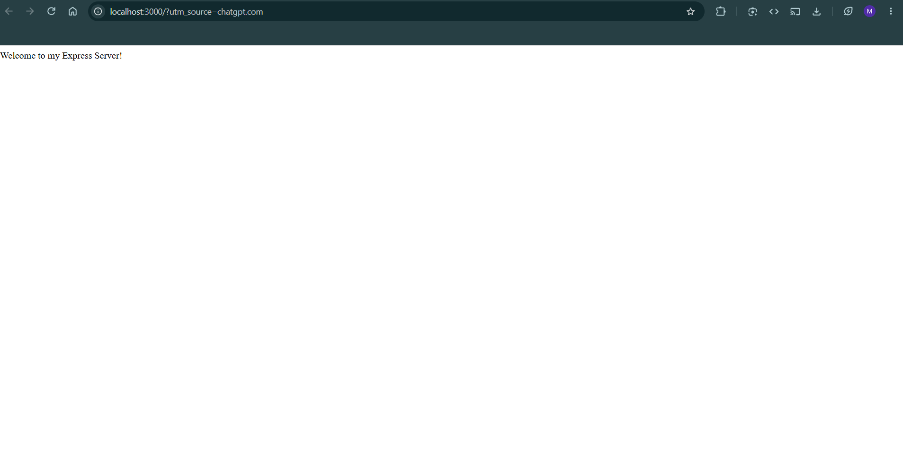
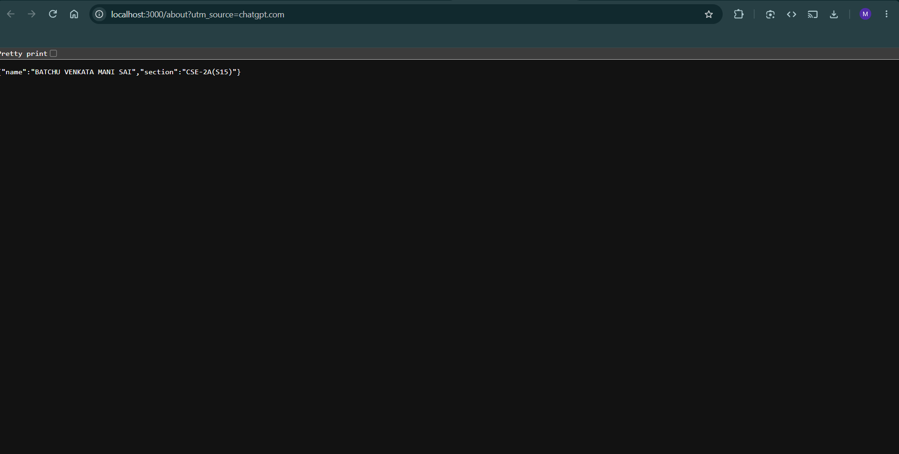
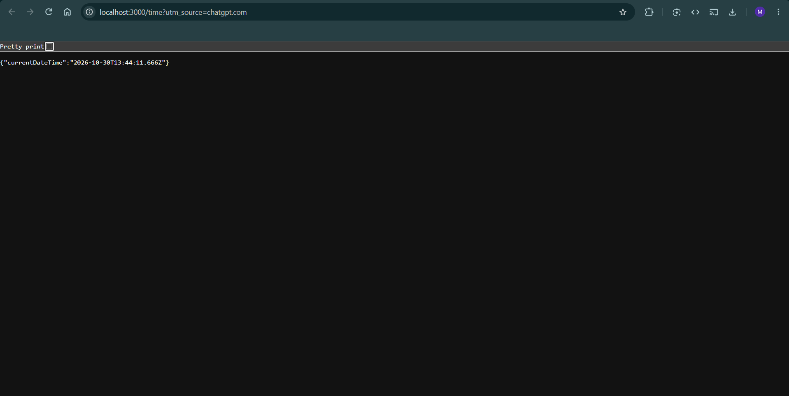
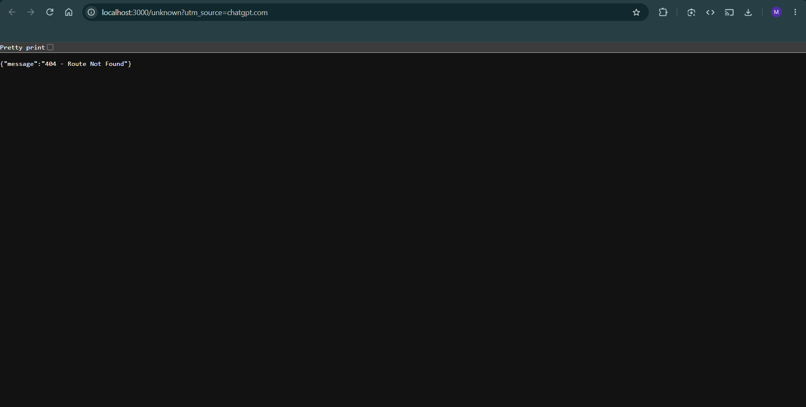

# Lab 1: Node.js and Express Server

## Student Details

- Name: BATCHU VENKATA MANI SAI
- Registration Number: 252U1R1029
- Section: CSE-2A(S-15)
- Course: B.Tech CSE

## Live Deployment


https://batchu-venkatamanisai.onrender.com

## Project Description

This project demonstrates how to create a web server
using Node.js and Express.js.

It includes a basic HTTP server, Express routes,
JSON responses and 404 error handling.

## Technologies Used

- Node.js
- Express.js
- JavaScript
- npm

## Installation

1. Clone the repository.
2. Navigate to the lab-01 folder.
3. Install dependencies.

```bash
npm install
```

## How to Run

Start the Express server:

```bash
npm start
```

Start the basic HTTP server:

```bash
node http-server.js
```

Server URL:  https://batchu-venkatamanisai.onrender.com


## Live API Endpoints

Base URL: https://batchu-venkatamanisai.onrender.com

| Method | Endpoint | Description | Status |
|---|---|---|---|
| GET | / | Welcome message | 200 |
| GET | /about | Student name and section in JSON | 200 |
| GET | /time | Current date and time in JSON | 200 |
| GET | /unknown | 404 error response | 404 |

### Test Links

- [Home](https://batchu-venkatamanisai.onrender.com/)
- [About](https://batchu-venkatamanisai.onrender.com/about)
- [Time](https://batchu-venkatamanisai.onrender.com/time)
- [Unknown Route](https://batchu-venkatamanisai.onrender.com/unknown)


## Screenshots

### Home


### About


### Time


### 404 Error


## Notes

Created a basic HTTP server using Node.js
and implemented API routes using Express.js.

Tested all endpoints and verified their
HTTP status codes.
