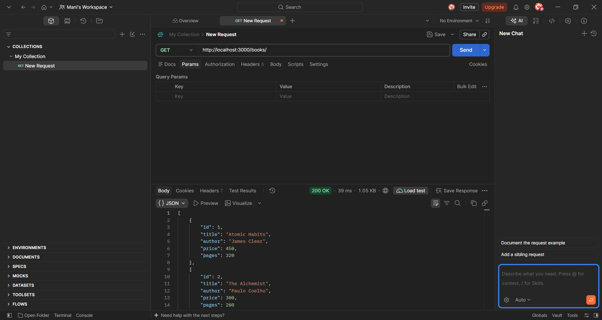
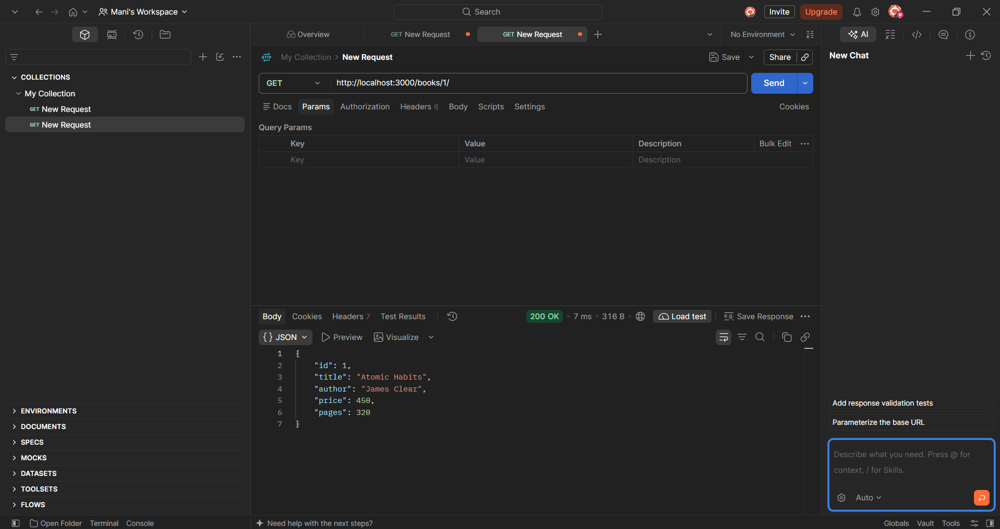
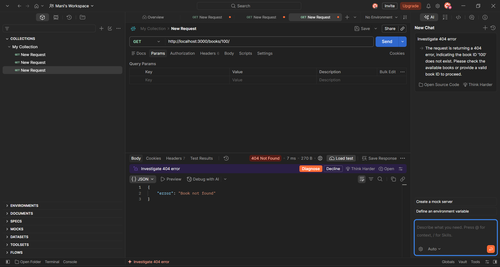
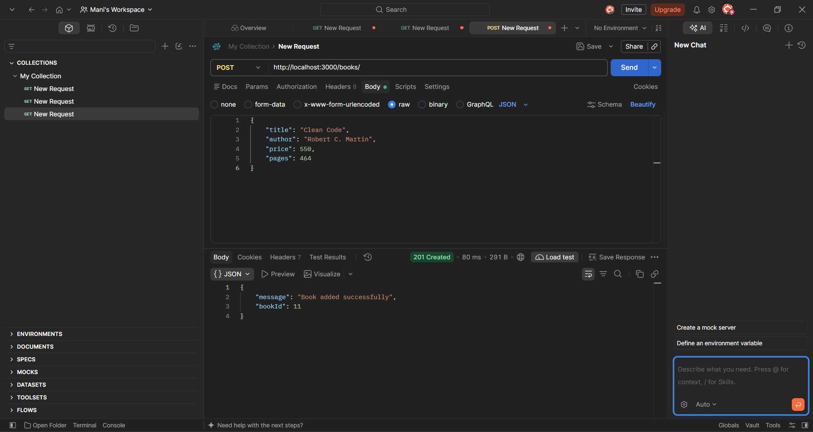
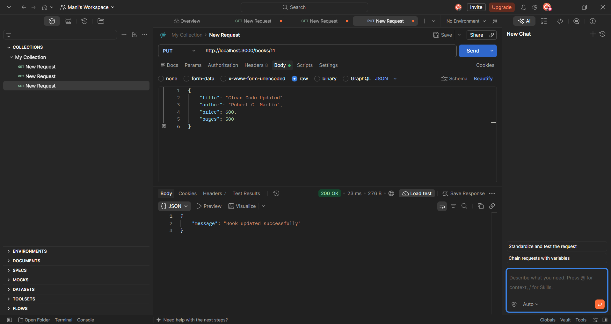
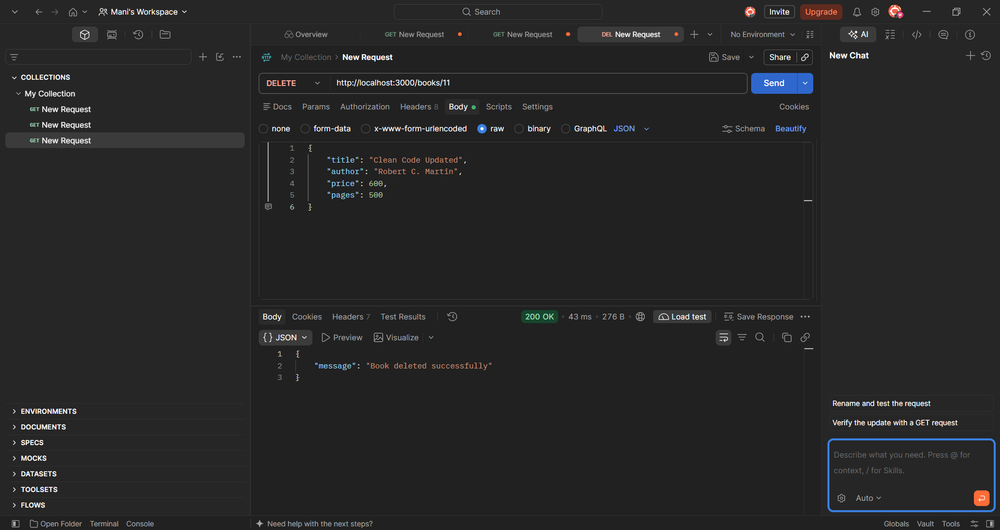
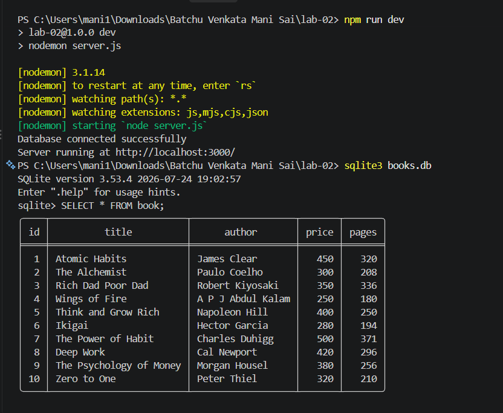
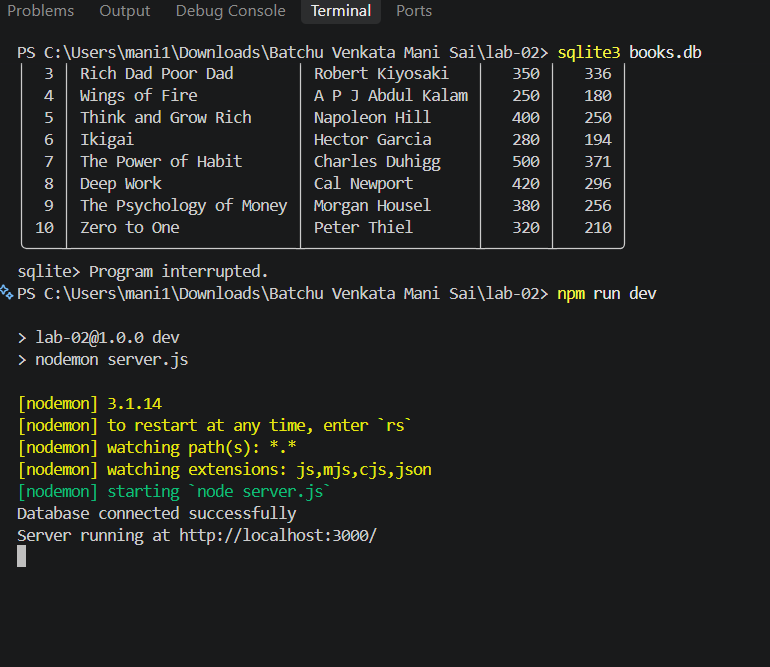

# Lab 2: SQLite Database and CRUD Routes

**Live Deployment:** [https://mani-lab-2.onrender.com](https://mani-lab-2.onrender.com)

## Student Details

- **Name:** BATCHU VENKATA MANI SAI
- **Registration Number:** 252U1R1029
- **Course:** B.Tech CSE
- **Section:** CSE-2A (S-15)

## Objective

Connect an Express server to an SQLite database and implement CRUD operations through HTTP routes.

## Technologies Used

- Node.js
- Express.js
- SQLite
- JavaScript
- Postman

## Installation

```bash
npm install
```

## Run the Project

```bash
npm run dev
```

**Environment Variable:**
- `PORT` – Server port (optional; defaults to 3000).

## Database

- **Database:** `books.db`
- **Table:** `book`
- **Initial records:** 10

## API Endpoints

**Base URL:** [https://mani-lab-2.onrender.com](https://mani-lab-2.onrender.com)

| Method | Endpoint | Description |
|---|---|---|
| GET | [https://mani-lab-2.onrender.com/books/](https://mani-lab-2.onrender.com/books/) | Get all books |
| GET | [https://mani-lab-2.onrender.com/books/1/](https://mani-lab-2.onrender.com/books/1/) | Get one book (example ID: 1) |
| POST | [https://mani-lab-2.onrender.com/books/](https://mani-lab-2.onrender.com/books/) | Add a book |
| PUT | [https://mani-lab-2.onrender.com/books/1/](https://mani-lab-2.onrender.com/books/1/) | Update book (example ID: 1) |
| DELETE | [https://mani-lab-2.onrender.com/books/1/](https://mani-lab-2.onrender.com/books/1/) | Delete book (example ID: 1) |

**Note:** Use Postman to send POST, PUT and DELETE requests with the appropriate HTTP method and request body. Clicking these links in a browser sends GET requests, not POST, PUT or DELETE.

## Screenshots

### 1. GET All Books


### 2. GET Single Book


### 3. Book Not Found


### 4. POST - Add Book


### 5. PUT - Update Book


### 6. DELETE - Remove Book


### 7. SQLite Database


### 8. Server Startup


## Problems Faced and Solutions

- Express module was missing. Installed it using `npm install express`.
- Configured the SQLite connection using `async/await`.
- Used parameterized queries with `?` placeholders to prevent SQL injection.